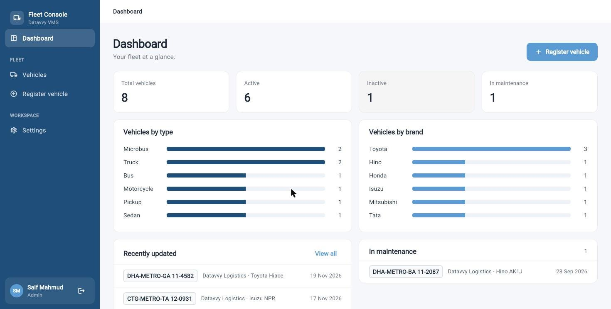
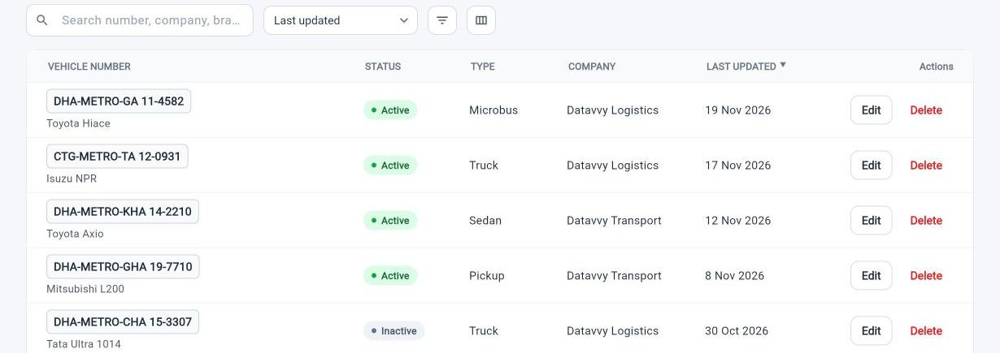
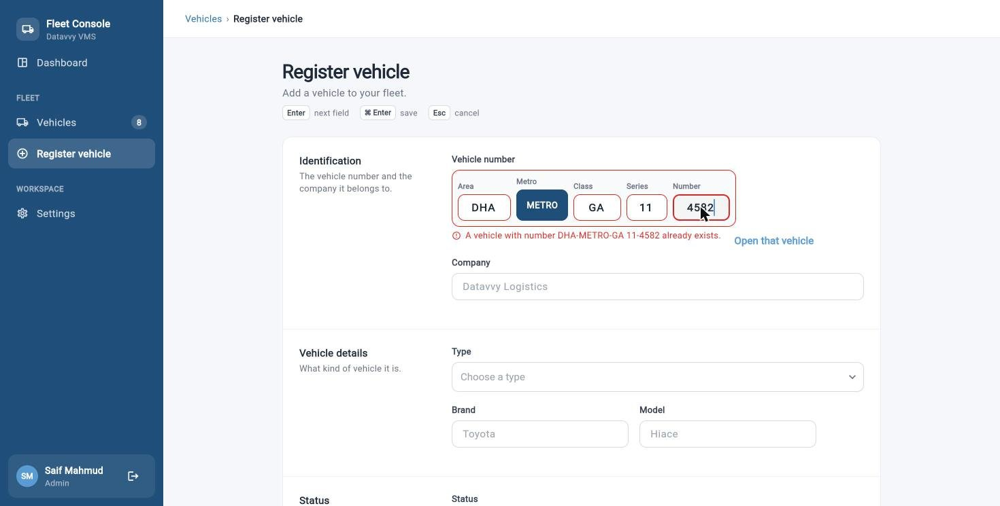
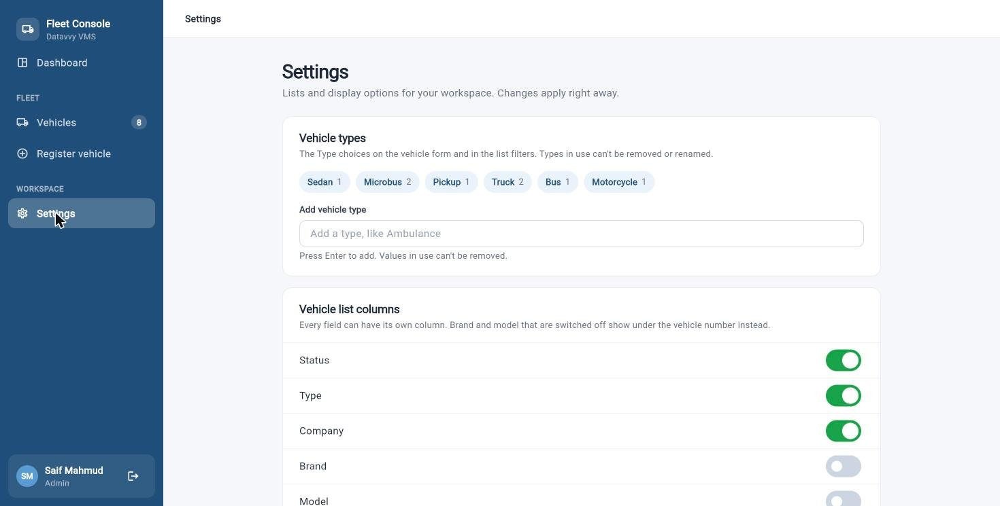

# Datavvy VMS — Web App (Flutter)

The web app for **Datavvy VMS**, a vehicle management system for a company fleet: sign in, see the fleet at a glance, search and filter vehicles, register and edit them with a live duplicate-number check, and manage settings. It's a Flutter **web** app built as a pub workspace of feature packages, so several teams can extend it without stepping on each other.

**Stack:** Flutter (Dart ≥ 3.14), web only · `material_ui` · `go_router` · `http` · MVVM with `ChangeNotifier`

**API:** [datavvy-vms-backend](https://github.com/MoZahidUl249/datavvy-vms-backend) (Spring Boot + MySQL), which also owns the API contract.

| | |
|---|---|
| Hosting | Netlify (free) · API on Render · database on TiDB Cloud |
| Demo video | [`docs/vms-demo.mp4`](docs/vms-demo.mp4) (1 min) |
| Demo logins | `admin@datavvy.com / Admin@12345` · `manager@datavvy.com / Manager@12345` · `viewer@datavvy.com / Viewer@12345` |

---

## Contents

1. [Screenshots](#screenshots)
2. [Features](#features)
3. [Five-minute demo](#five-minute-demo)
4. [User guide](#user-guide)
5. [Run it locally](#run-it-locally)
6. [Deploy on Netlify](#deploy-on-netlify)
7. [Structure](#structure)
8. [Design decisions and trade-offs](#design-decisions-and-trade-offs)
9. [Testing](#testing)
10. [Agentic workflow](#agentic-workflow)
11. [Known limitations](#known-limitations)
12. [Repository map](#repository-map)

---

## Screenshots

**Dashboard.** Fleet totals, breakdowns by type and brand, recently updated vehicles and vehicles in maintenance. Every number comes from the API.



**Vehicle list.** Search, sort, filters and a column picker; number plate, status, type, company and last-updated columns; Edit and Delete on each row.



**Register vehicle and the duplicate rule.** The number-plate input checks the API while you type and blocks a number that already exists.



**Settings.** Vehicle types with how many vehicles use each, list columns and dashboard cards.



---

## Features

### Vehicles

Every vehicle has exactly **Vehicle Number, Company, Type, Brand, Model, Status**.

| Feature | What it does |
|---|---|
| **Create, read, update, delete** | Register, view, edit and delete vehicles; every change goes through the API |
| **Duplicate Vehicle Number check** | While you type, the form asks the API whether the number exists and shows *"A vehicle with number … already exists"* with **Open that vehicle**. The API enforces the same rule on save |
| **Number-plate input** | Five boxes: Area · METRO · Class · Series · Number. Moves to the next box when one is full; METRO switches on for metro areas (DHA, CTG …); a digit typed in Class moves to Series; pasting a full number fills every box |
| **Status** | Active / Inactive / Maintenance, shown as colour plus a word |
| **Type from a managed list** | Chosen from the vehicle types in Settings |
| **Safe concurrent edits** | If someone else saved first: *"Reload to see their changes"* |
| **Keyboard-only entry** | Enter moves to the next field, ⌘/Ctrl+Enter saves, Esc cancels |
| **Validation** | A summary at the top lists each problem as a link to its field; each field says how to fix it |

### Vehicle list
- Status control with live counts: All / Active / Inactive / Maintenance
- Search across vehicle number (ignoring spaces and hyphens), company, type, brand and model
- Sort: last updated, recently added, oldest added, number A–Z / Z–A, or click a column header
- Filter panel: type, company, brand, *last updated on* and *added on* dates (the calendars only offer days that have data). Nothing applies until **Apply filters**, with a live "N vehicles match" count
- Applied filters as removable chips, with Clear all
- Column picker; brand and model show under the number when their columns are off
- Paging, loading skeletons, first-run and no-results states; delete asks for confirmation

### Dashboard
Cards for total, active, inactive and in-maintenance vehicles, each linking to the filtered list; bars by type and by brand; "Recently updated" and "In maintenance" lists. Optional cards are switched on or off in Settings.

### Settings
- Vehicle types: add by typing and pressing Enter. A type in use can't be removed or renamed; at least one type must remain
- List columns and dashboard cards: switches that apply immediately

### Accounts and roles
| Role | Can do |
|---|---|
| **Admin** | Everything, including Settings lists |
| **Fleet manager** | Create, edit and delete vehicles |
| **Viewer** | Read only: no Register, Edit or Delete; the form opens in view mode |

Signing in survives a page reload (the session is kept for the browser tab) and ends when the tab closes.

---

## Five-minute demo

1. **Sign in** as `admin@datavvy.com` / `Admin@12345` → the dashboard shows 8 vehicles: 6 active, 1 inactive, 1 in maintenance.
2. Click **In maintenance** → the list opens filtered to that status.
3. **Vehicles** → type `toyota` in search → 3 results. Open **Filters**, pick a company and a date, **Apply** → chips appear.
4. **Register vehicle** → type `dhaga114582` → the boxes fill, METRO switches on, and the form says the number *already exists*, with **Open that vehicle**. That's the business rule.
5. Change the number to `RAJ KA 11 1234`, fill in company, type, brand and model, press **⌘/Ctrl+Enter** → saved; its row flashes in the list.
6. **Edit** it → status Maintenance → save → the dashboard counts update.
7. **Delete** it → confirm → gone; counts back to 8.
8. Sign out, sign in as `viewer@datavvy.com` / `Viewer@12345` → no write buttons anywhere.

> On the free Render plan the API sleeps after 15 idle minutes; the first sign-in after that can take about a minute.

---

## User guide

**Signing in.** Enter your email and password and press Enter. If your session expires, you return to sign-in with a note explaining why.

**Finding a vehicle.** Open **Vehicles**. Use the status control, type in search (any part of the number, company, brand, model or type), or open **Filters**. Calendar days with a dot have vehicles added or updated that day. Click a number plate or **Edit** to open a vehicle.

**Registering a vehicle.**
1. **Vehicle number:** type it straight through (`dhaga114582`) or paste it (`DHA-METRO-GA 11-4582`). A red message means the format is incomplete or the number is already registered.
2. **Company, Type, Brand, Model:** all required. Type comes from the list in Settings.
3. **Status:** ← → to choose Active, Inactive or Maintenance.
4. **Register vehicle** or ⌘/Ctrl+Enter.

**Editing.** **Save changes** reads "No changes" until you change something.

**Deleting.** **Delete** on a row or **Delete vehicle** in the form, then confirm. Deletion is permanent.

**Settings.** Add vehicle types by typing and pressing Enter; remove one with its × (types in use show their count and can't be removed). Switch list columns and dashboard cards on or off.

| Shortcut (vehicle form) | Action |
|---|---|
| Enter | Next field |
| ⌘ Enter / Ctrl Enter | Save |
| Esc | Cancel, back to the list |
| ← → | Move between plate boxes / pick a status |
| Backspace in an empty plate box | Go back one box |

---

## Run it locally

Prerequisites: **Flutter** (stable, Dart ≥ 3.14) and **Chrome**. The app needs the API: start it with `run-backend.command` in [datavvy-vms-backend](https://github.com/MoZahidUl249/datavvy-vms-backend) (it runs without MySQL, using a local H2 file).

| Script | Does | Log |
|---|---|---|
| `run-web.command` | `flutter run` in Chrome on http://localhost:5173 against `VMS_API_BASE_URL` (default `http://localhost:8080/api`) | `web-run.log` |
| `build-web.command` | `flutter pub get`, format, analyze, `flutter build web` → `build/web` | `build-web.log` |

```bash
flutter pub get
flutter run -d chrome --web-port=5173 --dart-define=VMS_API_BASE_URL=http://localhost:8080/api
```

To point a local run or build at the deployed API, put `VMS_API_BASE_URL='https://<service>.onrender.com/api'` in `.env` (template: [`.env.example`](.env.example)).

---

## Deploy on Netlify

[`netlify.toml`](netlify.toml) has everything: Netlify has no Flutter preinstalled, so [`netlify-build.sh`](netlify-build.sh) fetches the Flutter SDK (cached between builds), runs `flutter build web` with the API address, and publishes `build/web`. Deep links such as `/vehicles/12` are rewritten to `index.html`.

1. Netlify → **Add new project → Import an existing project** → GitHub → this repo.
2. **Environment variables:** `VMS_API_BASE_URL` = `https://<service>.onrender.com/api`. Optional: `FLUTTER_VERSION` to pin the SDK (a release tag; default `stable`).
3. Deploy. Then add the Netlify URL to the API's `VMS_CORS_ORIGINS` on Render.

No Git? Put `VMS_API_BASE_URL` in `.env`, run `build-web.command`, and drag `build/web` onto Netlify (`web/_redirects` handles deep links).

---

## Structure

```
lib/main.dart              composition root: builds services, registers FeatureModules
lib/app/                   router (auth redirect, shell route), app shell (sidebar / drawer)
packages/
├── vms_core               ApiClient, Result<T>, ApiError, AuthSession (+ session store), AppRoutes, FeatureModule, UiPreferences
├── vms_design_system      tokens + widgets (VmsPage, VmsButton, PlateBadge, StatusPill, VmsDayPicker …)
├── vms_catalog            vehicle-type data shared by features
├── feature_auth           sign-in
├── feature_dashboard      dashboard
├── feature_vehicles       list, filters, register/edit, plate input
└── feature_settings       vehicle types, columns, dashboard cards
```

Each feature: `data/` (models matching the OpenAPI contract, repository returning `Result<T>`) · `domain/` (pure Dart rules) · `ui/<screen>/` (screen + view model) · `<feature>_feature.dart` (routes and sidebar items). A feature package never imports another; features plug in through `FeatureModule`, so the shell doesn't change when a feature is added.

---

## Design decisions and trade-offs

| # | Decision | Why | Trade-off | Revisit when |
|---|---|---|---|---|
| 1 | **Pub workspace + `FeatureModule` plugins** | Each team owns a package; adding a feature doesn't touch the shell; one lock file | More `pubspec.yaml` files; shared packages need careful review | — |
| 2 | **MVVM with `ChangeNotifier`, explicit dependencies** (no Riverpod/Bloc/get_it) | Follows the Flutter team's guidance; nothing extra to learn; easy to test with fakes | More wiring in `main.dart` | State gets complex across features → Riverpod |
| 3 | **Hand-written JSON models** | No `build_runner`; models read like the contract | Boilerplate; typos caught by tests, not the compiler | Many models → generated client from OpenAPI |
| 4 | **Web only, path URLs** | Matches the brief; clean links | No mobile apps; the host must rewrite unknown paths to `index.html` | Mobile needed → add platforms (packages are platform-neutral) |
| 5 | **Own design system package** mirroring the V8 design | Every screen consistent; agents build from known widgets | Upfront effort; Material widgets get wrapped | — |
| 6 | **Duplicate check while typing** (`/number-check`, 350 ms pause) | Immediate, friendly feedback before saving | An extra request per complete number; the API still enforces it | — |
| 7 | **Session in the tab's `sessionStorage`** | A reload keeps you signed in; closing the tab signs you out; not shared across tabs | Readable by scripts on the page (XSS risk), limited by the 8 h token | Refresh token in an httpOnly cookie |
| 8 | **API URL baked in at build time** (`--dart-define`) | No runtime config file; one static build per environment | Rebuild to change the API address | Many environments → load `config.json` at startup |
| 9 | **Netlify builds Flutter itself** (`netlify-build.sh`) | Push to deploy, no build server | First build downloads the SDK (cached after) | Slow builds → build in GitHub Actions and deploy the artifact |
| 10 | **UI preferences in memory** | Phase 1 scope | Reset on reload | Per-user preferences endpoint |

---

## Testing

| Where | Covers |
|---|---|
| `test/` | App shell: signed-out users land on the sign-in screen |
| `packages/vms_core/test` | API error parsing, session persistence (reload, sign-out, expired and corrupt stored sessions) |
| `packages/feature_auth/test` | Login view model |
| `packages/feature_vehicles/test` | Plate parsing, filters, JSON mapping |

```bash
flutter analyze
for p in . packages/*; do if [ -d "$p/test" ]; then (cd "$p" && flutter test) || exit 1; fi; done
```

CI (GitHub Actions) runs analyze, every package's tests and a release build on every push and pull request.

---

## Agentic workflow

Set up for **Google Antigravity** (also works with Claude Code, Codex and Cursor):

```
AGENTS.md              always loaded: stack, golden rules, commands, definition of done
.agents/rules/*.md     loaded by file pattern (Dart, UI, API models) + always-on guardrails
.agents/skills/        playbooks, each also a /slash-command; plus the Dart team's skills (dart-*, flutter-*)
.agents/agents/        read-only reviewer subagents
```

| Command | Use it to |
|---|---|
| `/plan-feature` | Turn a request into a package-by-package plan |
| `/new-flutter-feature` | Scaffold a feature package and register it in the shell |
| `/implement-screen` | Build a screen from the V8 design (`layout/`) with design-system widgets and every UI state |
| `/api-change` | Contract first (backend repo), then the Dart models and repositories |
| `/verify` · `/pr-ready` | Analyzer, tests and a browser check with evidence; reviewer subagents; PR description |
| `vms-ui` skill | The design language: colours, components, UX rules |

This app was built and checked with an agent: it read the V8 design canvas, built the packages, then ran the real app in Chrome to test sign-in, the dashboard, list filters, register/edit/delete, the duplicate rule, roles and settings, fixing what it found (a crashing delete dialog, an overflowing filter panel, a fast-typing bug in the plate boxes, sign-out on reload).

---

## Known limitations

- UI preferences (columns, dashboard cards) reset on reload.
- The first request after the free Render API has been idle takes about a minute.
- Roadmap: per-user preferences, refresh tokens, new feature packages (maintenance, fuel logs, drivers, documents, trips).

---

## Repository map

```
├── AGENTS.md                  agent + human guide (start here)
├── lib/  packages/            app shell + feature and shared packages
├── web/                       index.html, icons, _redirects
├── layout/                    V8 design canvas export (design source)
├── docs/                      screenshots/ · vms-demo.mp4 · adr/
├── netlify.toml netlify-build.sh   Netlify deployment
├── Dockerfile nginx.conf      container alternative (nginx + /api proxy)
├── run-web.command build-web.command   one-click scripts (macOS)
├── .env.example               local settings template
├── .agents/                   rules · skills · reviewer subagents
└── .github/                   CI · CODEOWNERS · PR template
```
